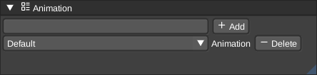
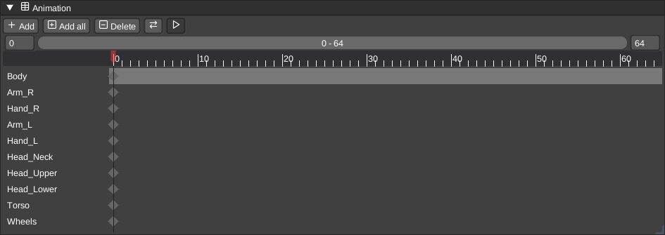

# Animations

Here you can change, create or delete animations from a scene.

## Timeline

The timeline shows the keyframes for each node in the active animation.

- Ctrl + mouse wheel: zoom horizontally around the pointer.
- Shift + mouse wheel: pan horizontally.
- Middle mouse drag: pan horizontally.
- Mouse wheel: scroll through node rows.
- Bottom scrollbar: pan through frames while keeping node names stationary.
- Home or the Frame all button: fit all keyframes with some extra space.
- Center playhead: center the view on the current frame without changing zoom.

## Cameras

You can also animate cameras to fly through your scene. Simply select the __camera__ node in the scene graph panel and set the keyframes in the timeline. Once you have the camera activated, you can simply press play to fly through your scene.
