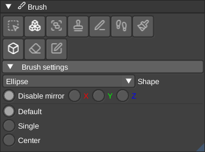

# Brushes

VoxEdit provides several specialized brushes for different types of voxel editing.

In Shape and ordinary Paint, a press-and-drag action is one undo step, including
edits to multiple grouped models. Stroke mode completes the path to the last cursor
position on release. Box and center modes apply when the shape is finished; if the
first drag is still a plane, move to set depth and click again. An edit that changes
no voxels preserves redo history. Switching tools, changing brush settings, or
changing the slice finishes the current edit; press again to start another. Shape
and Paint keep their settings when you switch away and back.

Voxel deletion previews mark affected existing voxels with a red hatch. Updates
show their prospective colors. These overlays respect scene occlusion.
Deletion shows the material that will be removed; newly exposed interior faces
appear after applying the edit.

## Shape brush

The shape brush creates geometric primitives by spanning a box in the viewport. Click and drag to define the size of the shape. The orientation is determined by which face you clicked on initially.

**Available shapes:**

- **Box**: Creates rectangular volumes. Can be hollow or filled depending on the modifier.
- **Torus**: Creates donut shapes with configurable radii.
- **Cylinder**: Generates circular columns along the axis perpendicular to the face you clicked.
- **Cone**: Creates tapered cylinders with the base on the clicked face.
- **Dome**: Generates hemisphere or half-ellipse shapes.
- **Ellipse**: Creates stretched spheres that fill the entire bounding box.

The shape is automatically oriented based on the surface normal of the face where you started dragging.
This allows you to naturally create shapes aligned with your viewing direction.

## Transform brush

The Transform brush adjusts selected voxels with move, rotate, scale, or shear.
Panel values and the viewport handle control the same operation. Changes appear
as a preview while the model remains unchanged. Use **Apply** to commit the
operation as one undo step, or **Cancel** (or Escape) to discard it. Switching to
another tool applies a valid preview. Switching transform modes applies the
previous mode before starting the next operation.

Undo, redo, slice changes, and replacing or removing an edited model discard the
pending transform preview. Saving applies a valid preview first; autosave keeps
the last committed model. Invalid parameters display an error and disable Apply
until corrected or cancelled.

## Paint brush

The paint brush provides various methods for coloring and modifying existing voxels. The brush only affects existing voxels and won't place new ones, making it ideal for recoloring models without changing their geometry.

**Paint modes:**

- **Replace**: Changes all voxels in the box to the cursor color
- **Brighten**: Makes colors lighter by a configurable strength
- **Darken**: Makes colors darker by a configurable strength
- **Random**: Replaces voxels with random colors from the palette
- **Variation**: Randomly brightens or darkens voxels for natural-looking surfaces
- **Blend**: Softly mixes the cursor color into existing voxels. Falloff is stronger at the brush center and fades to the edge of the radius. Strength controls how much paint is applied at the center (0 = none, 1 = full). While dragging, each voxel keeps the strongest coverage from the stroke (from its original color) so overlapping motion does not restack, but the brush center can still upgrade a weak edge touch.
- **Blur**: Gaussian-blurs each voxel using the colors of its solid neighbors (does not use the cursor color). Strength controls how strongly the blur replaces the original color. Uses the same stroke radius falloff as Blend.

**Special modes:**

- **Flood fill**: Fills all connected voxels of the same color on the clicked surface
- **Gradient**: Creates smooth color transitions across the box from the hit color to the cursor color

**Options:**

- **Strength**: For Brighten/Darken, controls the brightness adjustment (1.0 = no change). For Blend/Blur, controls opacity at the brush center (0 = none, 1 = full).
- **Variation chance (1 in N)**: For Variation mode, sets the chance to modify each voxel

## Plane brush

The plane brush creates or extrudes entire planar surfaces in a single action. Press on a face and hold the mouse button to preview the voxels across that surface. Move the cursor while holding to adjust the thickness, then release to apply the result. Plane editing uses the voxel preview without a gizmo.

This brush is particularly useful for quickly creating walls, floors, or large flat surfaces without having to manually span regions.

## Extrude brush

Select voxels with the Select brush, switch to Extrude, then click a voxel face
to set the direction. Adjust **Depth** in the brush settings or use the viewport
arrow. **Fill walls** keeps the sides connected, and the two **Offset** controls
shift the extrusion along the axes perpendicular to that direction. Negative
depth retracts the extrusion.

The result stays in an editable preview. Choose **Apply** to commit it or
**Cancel** to discard it. This differs from Plane, which follows a surface and
applies when you release the mouse button.

## Sculpt brush

Select the voxels you want to sculpt, then choose a mode in the brush settings:

- **Erode / Grow** remove surface voxels or expand the selected shape.
- **Flatten** levels a surface along a chosen face direction.
- **Smooth Additive / Smooth Erode / Smooth Gaussian / Smooth Wall** provide
  different smoothing methods, with mode-specific strength, iteration, kernel
  or interpolation controls.
- **Bridge Gap** connects separated surfaces.
- **Squash to Plane** reduces a shape toward a plane.
- **Reskin** applies a voxel skin with surface-following, rotation, tiling,
  offset and layer controls.

These modes use an editable preview with **Apply** and **Cancel**. Modes that
need a direction ask you to click a voxel face.

**Extend Plane** instead paints continuously over a surface. Its radius and
Extend only, Remove only and Remove above options control additions and removal.
Release completes one undo step for the stroke.

## Normal brush

Paint normals on existing voxels using **Manual** mode to choose a normal from
the [normal palette](Palette.md#normal-palette), or **Auto** mode to calculate
normals from neighboring voxels. Use stroke or box modes to choose the affected
region. Erase clears normals while keeping the voxels themselves.

Enable normal rendering to see the result. Normal data is used by formats such
as Command & Conquer VXL; it is separate from voxel color and material.

## Stamp brush

The stamp brush allows you to place pre-loaded voxel volumes repeatedly into your scene. Think of it as a copy-paste tool that keeps the copied content ready for multiple placements.

**Loading stamps:**

- Drag and drop any supported voxel file onto the viewport
- Right-click in the asset panel to select a stamp
- Create a stamp from a single voxel type with configurable dimensions

**Stamp modes:**

- **Center Mode**: The stamp is centered on the cursor position
- **Corner Mode**: The stamp's corner aligns with the cursor position
- **Continuous Mode**: Keep placing the same stamp with each click

**Offset**: You can configure an offset vector to shift where the stamp is placed relative to the cursor. This is useful for precise alignment or creating regular patterns.

## Line brush

The line brush draws straight lines of voxels from the reference position to wherever you click. The reference position (shown as a blue dot in edit mode) must be set first before using this brush.

**Line options:**

- **Thickness**: Sets the width of the voxel line.
- **Sag**: Adds a downward bend for a rope or cable effect in straight-line mode.
- **Bezier**: Click to lock a segment's end, then adjust its control point with
  the viewport handle. Pending segments remain editable until **Apply** or
  leaving the brush; **Cancel** discards them. Continuous mode chains segments.
- **Stipple pattern**: A 9-bit pattern that controls which voxels are placed along the line. Each bit represents one step - set bits place voxels, cleared bits skip them. This allows creating dashed or dotted lines.
- **Continuous Mode**: When enabled, the end point of each line becomes the reference position for the next line, allowing you to chain line segments together without manually updating the reference position.

Lines are drawn using raycasting, ensuring a clean voxel path between the two points.

## Ruler brush

Click a start point, then an end point to measure without changing voxels. The
brush settings show the endpoints, per-axis delta, straight-line **Length**, and
**Manhattan** distance (the sum of steps along each axis).

Enable **Use reference position** to measure from the
[reference position](ReferencePosition.md) to the cursor. A new measurement
replaces the previous one.

## Text brush

The text brush voxelizes TrueType fonts into your volume, allowing you to add text labels or create text-based voxel art.

**Text options:**

- **Font**: Choose any TrueType font file (.ttf) from your system
- **Size**: Controls the font size, which determines the height and width of generated characters
- **Spacing**: Sets the distance between individual characters
- **Thickness**: Defines how deep/thick the text appears in 3D space
- **Input**: The text string to generate

The text is placed at the cursor position.

## Texture brush

The texture brush projects image textures onto voxel surfaces, automatically mapping colors from the image to the closest matching colors in your palette.

**Texture options:**

- **Image**: Load any supported image format (PNG, JPG, etc.)
- **UV Coordinates**: Define which portion of the texture to use (UV0 to UV1)
- **Project onto surface**: When enabled, the texture is projected onto existing voxel surfaces. When disabled, it fills the spanned box volume.

The texture brush is excellent for adding detailed patterns, logos, or textures to models by converting pixel art into voxels.

## Script brush

Execute custom [Lua scripts](../../LUAScript.md) with this brush. Scripts can perform complex operations that aren't possible with the standard brushes, like procedural generation, mathematical transformations, or automated editing tasks.

Check the scripts panel to see available scripts and their parameters. Many scripts use the reference position, cursor position, or current selection to define where they operate.

Script errors are reported to the editor. Changes made before an error remain part of the edit and can be undone.

## Select brush

The select brush doesn't modify voxels directly. Instead, it creates selection regions that limit where other operations can affect voxels (like the [script](../../LUAScript.md) execution) or for copy/pasting.

Choose **Select > None** to clear the selection before operating on the whole
volume again.

**Using selections:**

1. Switch to the Select brush and choose a selection mode.
2. Use **3D Box** to drag a box, or choose another mode below.
3. Operations like painting, scripts, or other brushes will only affect voxels inside the selection
4. Use **Select > None** to clear the selection and work on the entire volume again.

Available modes include **All**, **Surface**, **Same Color**, **Fuzzy Color**,
**Connected**, **Flat Surface**, **3D Box**, **Circle**, **Lasso**, **Brush select**
and Lua **Script** selections. Circle can also select a 3D ellipsoid. Fuzzy Color
has a color threshold; Flat Surface has a surface-deviation setting. Brush select
uses a round radius while you hold and drag.

Selections are useful for protecting parts of your model while editing other areas, or for applying operations to precise regions.

## Color picker

You can either use it from the modifiers panel or by default with the key `p` to pick the color from the current selected voxel.

## Editable operations and preview

Transform, Extrude, adjustable Sculpt modes and Bezier lines keep an editable preview until Apply.
Sculpt Extend Plane paints continuously as a stroke, with one undo action on release.
Cancel or Escape discards the draft. Leaving a tool applies its valid draft;
undo/redo and external model changes discard it. Autosave writes committed data.
The preview includes removed source voxels and does not modify the saved model.

While defining a Shape box, its Minimum and Maximum fields and viewport bounds
handle edit the same region. Stroke release and the box depth step keep their
usual completion behavior. Bezier segments expose start, end and control handles.
