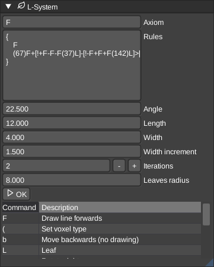

# LSystem

The L-System (Lindenmayer System) generator allows you to create complex procedural structures like trees, bushes, and other organic shapes using a set of rules and parameters.

## Parameters

* **Axiom**: The initial state string (the seed) of the L-System.
* **Rules**: A list of production rules that define how symbols are replaced in each iteration.
    * **Predecessor**: The character to replace.
    * **Successor**: The string to replace the predecessor with.
* **Angle**: The angle in degrees for rotation commands.
* **Length**: The length of the segments drawn by the turtle.
* **Length scale**: Multiply the current length after each `F`. Use `1` for constant length or e.g. `0.85` for progressively shorter outer branches. Returning from a branch restores its parent's length.
* **Minimum length**: Lower bound when length scaling is enabled. Fractional lengths are supported.
* **Angle variation**: Random variation around the rotation angle in degrees. Use `0` to disable it.
* **Seed**: Controls both angle variation and leaf sampling. The same settings and seed reproduce the same tree.
* **Leaf color**: Palette index for foliage. Defaults to the closest green in the node palette. `-1` uses the current turtle voxel. Drag a color from the palette panel onto the field. Does not change the color of subsequent branches.
* **Width**: The initial width of the segments.
* **Width increment**: The amount to increment or decrement the width when using width commands.
* **Iterations**: The number of times the rules are applied to the axiom. Higher values create more complex structures but take longer to generate.
* **Leaves radius**: The radius of the leaves generated by the 'L' command.

## Commands

The L-System uses a "turtle" graphics approach where a cursor moves through 3D space following these commands:

| Command | Description |
| :--- | :--- |
| `F` | Draw line forwards |
| `(` | Set voxel type |
| `b` | Move backwards (no drawing) |
| `L` | Generate a leaf |
| `+` | Rotate right |
| `-` | Rotate left |
| `>` | Rotate forward |
| `<` | Rotate back |
| `#` | Increment width |
| `!` | Decrement width |
| `[` | Push state (save position, direction, length, width and voxel) |
| `]` | Pop state (restore the saved branch state) |

## Templates

VoxEdit comes with several built-in templates to get you started:

* **Simple Tree**: A basic tree structure that branches in 4 directions.
* **Dense Bush**: Short, wide, and bushy with many leaves.
* **Monopodial Tree**: A continuing trunk with separately branching lateral limbs.
* **Pine Tree** and **Conifer-like**: Tiered lateral branches with foliage; older lower branches have more growth iterations.
* **Natural Branching Tree**: Tapered limbs, segment length scale `0.85`, and seeded angle variation of `5` degrees.
* **Fern 3D**: Branches on both rotation axes.
* **Bamboo**: Leaves extend away from the stem along short branches.

Tree names describe stylized growth patterns rather than botanically exact species. Select a wood color before generating and set **Leaf color** to a foliage entry in your palette for a two-color tree.

For a compact tree, try axiom `X` and rule `X -> FF[!+X][!->X][!<X]!FL`, angle `28`, length `5`, length scale `0.85`, minimum length `1`, width `4`, width increment `0.8`, iterations `4`, and leaf radius `2`. This is the Natural Branching Tree template.

The optional final `options` table in `g_lsystem.generate` exposes `lengthScale`, `minLength`, `angleVariation` (degrees), `seed`, and `leafColor`. Tables returned by `g_lsystem.templates()` include these fields and can be passed directly as `options`; existing positional calls remain supported.

For a visual check, run `vengi-testvolumerenderer --lsystem "Natural Branching Tree" --screenshot 5`.

## Usage

* **Select a Template**: Start by selecting a template from the dropdown menu to see how it works.
* **Modify Parameters**: Adjust the angle, length, and iterations to change the shape and size of the generated structure.
* **Edit Rules**: Add or modify rules to create custom branching patterns.
* **Adopt Dimensions**: Measures the generated shape and scales length, width, leaf radius and related sizes so the result fits the current volume. The turtle origin is placed on the volume floor and centered in XZ. Generation also expands the node region if any voxels would otherwise be clipped.
* **Generate**: Click "OK" to generate the voxel structure at the reference position.

> **Tip**: Use the `[` and `]` commands to create branching structures. `[` saves the current position and direction, allowing you to draw a branch, and `]` restores the saved state to continue from the branching point.
