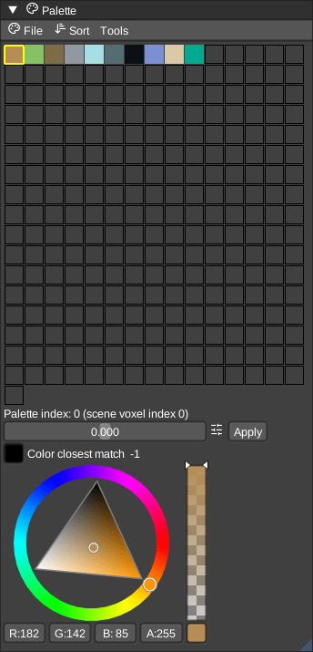

# Palette

The palette panel visualized the colors for a node. The colors can get re-ordered and changed, as well as drag-and-dropped to change the slots. See the dedicated [palette](../../Palette.md) docs for more details.

You can re-order the palette colors by __Hue__, __Saturation__, __Brightness__ or __CIELab__ rules.

Direct LoSpec palette import is possible and next to LoSpec you can import or export a lot other palette [formats](../../Formats.md), too.

Both palette panels have an **Options > Palette color size** slider. It controls the
shared `ve_palettecolorsize` setting, from 0.5 to 4 times the UI frame height.

## Selection

* **Left Click**: Select a single color. This sets the current voxel color for painting.
* **Ctrl + Left Click**: Toggle selection of multiple colors.
* **Shift + Left Click**: Select a range of colors from the last selected color to the clicked color.

## Drag and Drop

* **Reorder**: Drag a color to another slot to swap them.
* **Sort**: Hold **Ctrl** while dragging to reorder the palette entries without changing the colors of the existing voxels in the scene.
* **Import**: Drag and drop an image file onto the palette panel to import it as a new palette.

## Shortcuts

* **Ctrl + C**: Copy the hovered color.
* **Ctrl + V**: Paste the copied RGBA color into the hovered slot, preserving its material and name.

## Context Menu

Right-click on a color to open the context menu. Color, name, and material editors are at the top; actions below are grouped into **Color**, **Material**, and **Palette entries**:

* **Copy Color / Paste Color**: Copy RGBA only, preserving the destination material and name. Colors can also be pasted into empty slots.
* **Copy Material / Paste Material**: Copy the complete material type and properties, preserving the destination color and name. Paste is available after copying a material.
* Pasting from the context menu applies to all selected entries when the clicked entry is selected; otherwise it applies only to the clicked entry. One undo restores the whole paste. Copied values remain available when switching nodes or palettes.
* **Color Picker**: Adjust the color using the color picker.
* **Material Properties**: Choose material type (Diffuse / Metal / Glass / Emit / Blend / Media). Changing type applies that type's property defaults. Then adjust metal, roughness, IOR, emit, and the other sliders.
* **Remove Alpha**: Remove transparency from the color.
* **Model from Color**: Create a new model containing only voxels of this color.
* **Duplicate Color**: Duplicate the selected color into a free slot.
* **Remove Color**: Remove the selected color from the palette.
* **Reduce to Selected**: Reduce the palette to only the selected colors.
* **Randomize Selected Colors**: Assign random colors to the selected slots.
* **Name**: Rename the color.

## Normal Palette

The Normals panel selects directions for normal painting. Manual painting changes
only the painted voxels; automatic painting calculates directions from nearby voxels.

Changing the normal palette maps existing voxel normals to the closest directions
in the new palette. This can introduce approximation because palettes contain different
directions. Undo restores both the previous palette and the previous normal indices.
Changing the color palette preserves voxel normals.

### Editing normal entries

Left-click any normal slot, including an empty slot, to select it. Adjust the vector,
longitude/latitude, axis presets, flip, or rotation controls below the grid. Valid edits
immediately update the direction and its color swatch. Directions are normalized; zero
and non-finite vectors are rejected. Each slider drag or completed input edit is one
undoable change. Editing an entry affects every voxel referencing it without changing
the stored normal indices.

An empty slot becomes populated as soon as a valid direction is entered. **Add normal**
can also create the default direction without editing it. Selecting an empty slot alone
does not activate it for painting. The grid contains 255 normal entries; a voxel with
no normal is a separate state, not an extra editable slot.

Right-click a slot to **Copy normal**, **Paste normal**, or **Duplicate normal**. Copy/paste
also works with Ctrl+C / Ctrl+V over the grid, including pasting into empty slots and
across nodes. Copies are snapshots of the direction, independent of later source edits.

Drag an entry onto another slot to swap them. Painted voxel references are swapped too,
so their directions remain unchanged. Dropping onto an empty slot moves the entry.
Entry edits, paste, duplication, and swaps support undo/redo; a swap restores both the
palette entries and voxel references in one undo.
