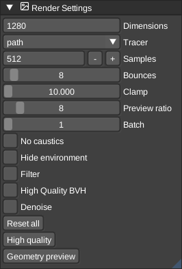

# Renderer

The **Render** viewport uses GPU path tracing to render visible models with shadows, reflections, glass and emissive materials. Each model uses its own palette. See [Materials](../../Material.md) for the supported material properties.

Rendering starts when you open the viewport. Its camera initially matches the last active edit or scene viewport, then moves independently. Use the usual mouse controls or the view cube to orbit it. Changes to the scene, camera or most rendering settings restart sampling; exposure, contrast, saturation and vignette update a finished preview without restarting. Choose **Save image** in the viewport's menu bar to export a PNG.

## Settings

* **Quality presets** - Reset all restores defaults. High quality uses 1024 samples and 8 bounces, with rounded voxel edges and bloom. Preview uses 16 samples and 2 bounces. These are pathtracer quality shortcuts, not the sun presets.
* **Quality** - More samples reduce noise; more bounces allow longer light paths (up to 12). Samples per pass controls how much work is submitted each frame. Voxel edge rounds exposed corners. Render scale (0.25-1) reduces the image dimensions, including the saved PNG.
* **Output** - Image dimensions (square, default 512), exposure, tone mapping, contrast, saturation, vignette and bloom.
* **Camera** - Depth of field, aperture and focus distance.
* **Lighting** - Sun direction, intensity, softness and color; sky colors; floor; background; fog and atmosphere.

Sun elevation, azimuth and the **Preset: Noon / Evening / Morning** sun shortcuts are shared with **Scene settings**. Changing the direction in either panel updates both renderers.

## Scene size and performance

Empty space is cheap: only filled 8x8x8 regions are stored. On a typical desktop GPU you can expect on the order of **tens of millions of solid voxels** inside a bounding box of roughly **2000^3** voxels (higher if your driver reports a larger 3D texture limit). Very large boxes may still be truncated; the menu bar then warns that the volume was clipped to GPU limits. At most **4096** emissive voxels are used for light sampling.

For a faster preview, use fewer samples, disable rounded edges or lower the render scale. A scale of 0.5 traces about one quarter of the pixels. Glass, media and rounded edges can take longer to render. A completed preview is reused until its image or display settings change.

See [Path tracer](../../PathTracer.md) for a full artist-oriented overview of limits and settings, plus algorithm references and benchmarks for developers.
