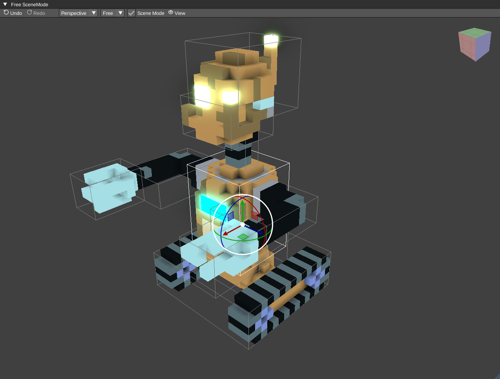

# Viewport

Switch between [scene and edit mode](SceneAndEditMode.md) to arrange nodes or edit
their voxels. The [camera](Camera.md) supports perspective, orthographic and
isometric views. You can also animate a [camera node](Animations.md#cameras) or
set its rotation speed (`omega`) for a rotating model view.

The viewport's **View** menu controls the grid, gizmos, bounding box, bones,
outlines, checkerboard and bloom. The **Viewport HUD** option shows the current
brush or add-node controls in the active viewport. Use the
[2D Views panel](2DViews.md) for editable cross-sections.

## Screenshots and video

Choose **View > Screenshot** in the viewport to save an image. This captures the
model or scene without the editor's panels and brush overlays.

Choose **View > Video** in the viewport to start capture. The save dialog selects
the output format: AVI by default, MPEG2 for a `.mpeg` filename, or GIF for `.gif`.
Choose **Stop recording** from the same menu to finish. Camera rotation and
animated scenes can be captured this way.

To save replayable editing changes instead of rendered frames, use
[session recording](SessionRecording.md) from the main **File > Record** menu.
